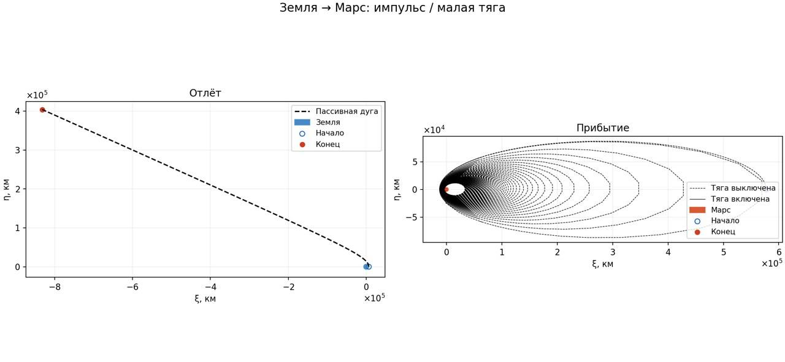
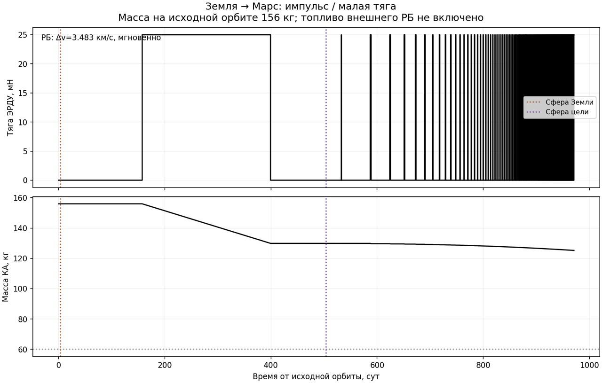

# Угловая скрутка, топливный бюджет и полная сшивка

Реализация и проверка 8 ноября 2026, только Linux Docker. Добавлены отдельные
флаги, общий контракт углового закона, событийное интегрирование, независимое
обнаружение переключений при прямом пересчёте, сшивка каждого кандидата и
дискретный поиск полной длительности под запас топлива.
[Инструкция и схема параметров](../.agents/skills/trajectory-pipeline/references/angular-capture.md).

## Подбор на полной миссии Земля–Марс

156 кг на НОО 200 км; внешний РБ; начало межпланетного участка 01.12.2030,
500 суток до марсианской границы. ЭРДУ 0.025 Н, c=20 км/с; сухая масса 60 кг;
конечная орбита Марса 400×30000 км. Один общий исходный физический результат
использован как приближение для всех кандидатов, без продолжения от соседнего
окна. Бюджет на скрутку — 6 кг, предельная длительность скрутки — 1800 суток.

| Полуширина | Полная миссия, сутки | Топливо скрутки, кг | Конечная масса, кг | Исход |
|---|---:|---:|---:|---|
| 2.0 рад (114.59°) | 1625.320 | 2.671 | 127.114 | Принят |
| 2.4 рад (137.51°) | **970.786** | **4.653** | **125.241** | Выбран из допустимых |
| π, без отключений | 619.946 | 8.484 | 122.113 | Отклонён: бюджет 6 кг превышен |

В выбранном варианте скрутка длится 467.096 суток, двигатель работает
43.081 суток. Полная длительность дополнительно включает межпланетные
500 суток и отлёт до границы. Расход КА за всю миссию — 30.759 кг.
Топливо внешнего РБ не включено. Все кандидаты заново согласованы по
состоянию и массе с физической ПСИ; самый быстрый недопустимый вариант
не выдан как результат.

Первичные данные и сохранённые запросы:
`data/benchmarks/angular_capture_v1/mars_search_fuel6/`.
В корне находятся `capture_search.json`, `summary.json`, `verification.json`;
в `candidates/000..002/` — исходы каждой полной миссии. Для отказа по бюджету
сохранена полная проверка, а статус остаётся `partial`. Воспроизводимый
запрос — `configs/angular_capture/mars_fuel6.json`.

## Другие составные случаи и отрицательные исходы

- **РБ → ПСИ → окно 2 рад, Марс:** полная приёмка; архив `mars_fixed/`.
  Он также служит единым физическим приближением для поиска выше.
- **Раскрутка → ПСИ → окно 2.4 рад, Марс:** полная приёмка. Масса на входе
  в межпланетный участок 108.512643 кг, после скрутки 82.579280 кг;
  расход на скрутку 3.080061 кг, общий расход КА 73.420720 кг.
  Оба стыка прошли проверку массы и вектора скорости; ошибка стыка времени
  в сохранённом результате нулевая. Архив `mars_spiral_departure/`, запрос
  `configs/angular_capture/mars_spiral_departure.json`.
- **Окно 2 рад, бюджет скрутки 1 кг:** после полной сшивки кандидат
  отклонён. Корень поиска возвращает `no_verified_feasible_capture_candidate`
  и не содержит выбранной миссии. Проверен реальный CLI с переопределением
  параметров; итоговые свидетельства `angular_capture_v1/no_feasible_*.json`.
- **Венера, 01.11.2032, 390.8 суток межпланетного участка:** полная сшивка
  остановилась после общих 16 итераций. Отлётная позиционная невязка
  26.003748 м при пороге 0.05 м, массовая невязка прибытия 7.25e−7 кг.
  Принятой составной миссии нет. Сохранены параметры, вся история согласования
  и последняя принятая внешняя ПСИ в `venus_partial/`; это архив свидетельств,
  не полный checkpoint для продолжения всех промежуточных итераций.
  Настройки ради приёмки не изменялись. Запрос `configs/angular_capture/venus_2032.json`.

Пути архивов в этом разделе относительны
`data/benchmarks/angular_capture_v1/`. Наличие локальной скрутки не означает
сходимость совместной миссии. Отказ итерационного согласования Венеры не
доказывает её физической недостижимости.

## Семь самостоятельных физических скруток

В таблице масса относится к **концу скрутки**, а не к НОО. Для каждого
варианта выполнены обратное построение и независимое прямое интегрирование
с повторным поиском событий, сопоставлены весь массив состояний, масса,
расход и моменты переключений. Пороги: 100 м, 0.01 м/с, 1e−6 кг и 0.05 с.

| Случай | Конечная масса, кг | F, Н / c, км/с | Закон | Δr max, м | Δv max, м/с |
|---|---:|---|---|---:|---:|
| Марс | 90 | .025 / 20 | θ=2 | 1.043 | 0.000689 |
| Марс, другой двигатель | 60 | .040 / 16 | θ=2.7 | 0.00686 | 0.00000452 |
| Венера | 80 | .040 / 22 | θ=2 | 2.369 | 0.002001 |
| Земля | 110 | .060 / 25 | θ=2.4 | 0.150 | 0.0000914 |
| Церера | 60 | .002 / 16 | θ=2 | 0.0220 | 0.00000978 |
| Марс, фиксированная ось | 90 | .025 / 20 | θ=2.4 | 0.403 | 0.000266 |
| Марс, зависимость от e | 90 | .025 / 20 | θ=1.8+0.25e | 0.893 | 0.000589 |

Все семь прошли. Максимальная массовая невязка 4.98e−10 кг, расхождение
событий до 0.000257 с. Первичные параметры, результаты и код запуска —
`angular_capture_v1/local_matrix.json`, `angular_capture_v1/local_matrix.py`.
Повторение: `docker compose run --rm -T -e PYTHONPATH=/workspace --entrypoint python pipeline reports/angular_capture_v1/local_matrix.py --output runs/new_angular_matrix/results.json`.
Сферы и орбиты заданы явно в центральном поле; эта проверка не является
проверкой приливных возмущений у границы сферы или N-body-моделью Цереры.

## Проверки реализации и границы

Полный набор **76/76 тестов прошёл локально в Docker**. Проверены реальные
скрутки, геометрическая инвариантность, CLI/JSON-параметры, бюджеты, поиск,
отказ по сроку, защита от подмены управления/расписания и сохранённые полные
миссии. Старые четыре сочетания манёвров, ПСИ, УММП и CR3BP также прошли.
Журнал — `angular_capture_v1/tests.log`; контрольные суммы материалов —
`angular_capture_v1/manifest.json`. Предыдущая проблема GitHub с независимым
пересчётом старого захвата здесь не объявляется исправленной.

Исходные MATLAB-скрипты не менялись. Наличие `capture_control` явно выбирает
новый интегратор; без поля сохранён прежний контракт. При почти круговой
орбите выбирается `fixed_axis`, а не неопределённый перицентр. Ультраузкие
окна исключены явной валидацией. Поиск даёт минимум среди объявленных
кандидатов, не глобальный минимум по всем возможным законам управления.
Совместный режим угловых скруток с историческим УММП и N-body не реализован
и не заявлен. Луна не возвращалась в цели метода.
