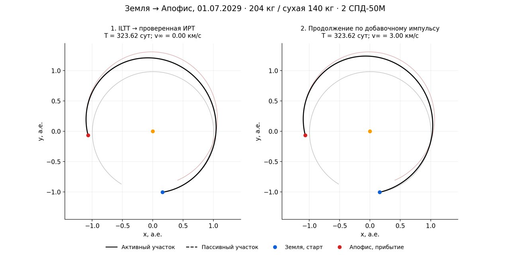
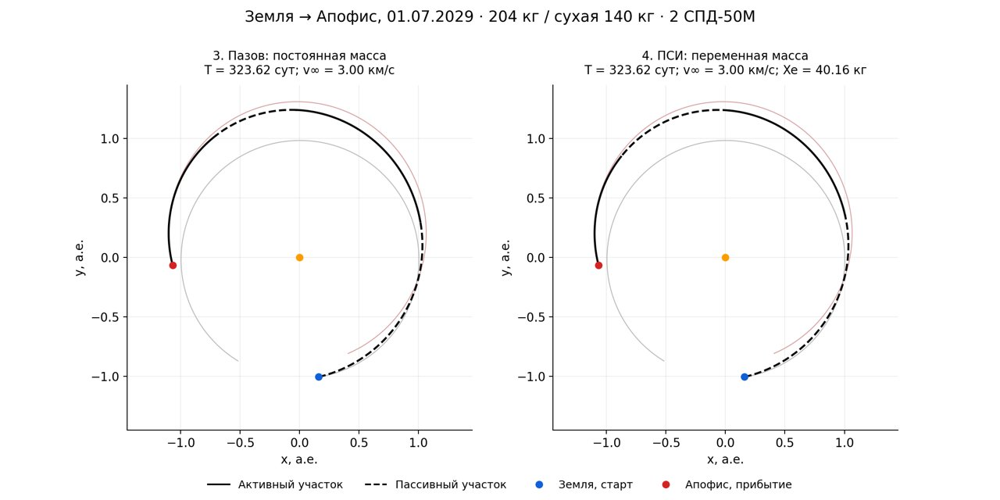
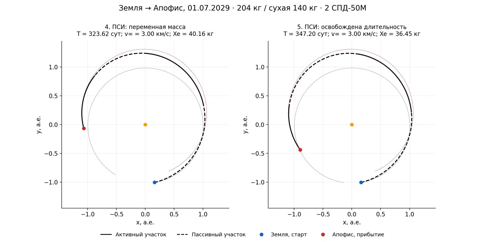

# Апофис: причины отказа и последовательная проверка классической цепочки

12 ноября 2026. Linux Docker. [Входная миссия](../configs/apophis_spd50m_204.json),
[массивы, журналы, воспроизведение и SHA256](../data/benchmarks/apophis_classical_204_v1/README.md).

Для старта **01.07.2029** с нуля получена цепочка **дата → фаза → угловая
ветвь ILTT → ИРТ → добавочный импульс → Пазов → физическая ПСИ → свободная
длительность**. Старые физические опоры, генетический поиск и перенос готовой
ПСИ здесь не использовались. Обычный `solve` независимо воспроизвёл итог.

## 1. Причина отказа ILTT

Прежнее объяснение через близость размеров орбит было неполным. Найден
конкретный дефект взаимодействия начального приближения и корректора:

- `calculate_dm_for_Reo_matrix` оценивает параметр Δm через коэффициент,
  пропорциональный κ−1. При заметном эксцентриситете и κ около единицы
  оценка Δm выходит далеко за рабочую область последующего преобразования.
- `calculate_Reo_matrix_noapprox` молча ограничивает Δm интервалом
  **[−0,598199639; +0,598199639]**. Для 01.07.2029 начальная оценка
  **−0,683114626**, для прежней даты 14.02.2029 — **+0,889892704**.
- Вне этого интервала изменение Δm не меняет матрицу R, сопряжённые и
  конечное состояние. На реальных входах Апофиса численно подтверждена
  **точно нулевая** чувствительность конечного состояния по Δm.
  Якобиан шестипараметрического согласования получает нулевой столбец.
- Прежний неограниченный `hybr` пытался исправлять именно эту вырожденную
  постановку; в старых журналах параметр уходил до миллионов без изменения
  действующего преобразования. Это отказ до ИРТ, не недостаток тяги двигателя.

Изменение массы или двигателя не устраняет этот дефект: на данном этапе ILTT
они не входят в фазовое согласование. Регрессионная проверка использует
Апофис из прежней матрицы с прежним аппаратом и также получает принятую ИРТ.

### Исправление общего модуля

В `trajectory_pipeline/iltt_entry.py` сохранены исходные формулы ILTT и
R-преобразования. При насыщенном начальном Δm используется корректор
`least_squares` внутри действующей области R. Он также доступен после
неудачи обычного корректора. Начальная оценка проектируется внутрь области;
последующие итерации не попадают на плоский участок обрезания.

Общая численная область коррекции: Δm в указанном интервале, j∈[−30,30],
κ∈[0,1;10]; λ остаётся положительной внутри выбранной угловой ветви.
Это область локального поиска, а не доказанные физические пределы метода.
Она одинакова для всех тел и дат. Маршрут и область записываются в
`iltt_resolved.correction_attempts`; исходное насыщение — в
`initial_transform_saturated`. Никакого специального условия `target=Apophis`
в решателе нет. Математика Toolbox и его ограничение Δm не менялись.

Экспериментальное расширение области самого R-преобразования не дало
устойчивого преимущества и в рабочий код не перенесено. Диагностические
варианты `extended` сохранены отдельно от принятых расчётов.

## 2. Постановка и последовательность этапов

Начальная масса **204 кг**, сухая **140 кг**, запас ксенона **64 кг**.
Два СПД-50М одновременно работают на номинальном режиме: по **18 мН** и
**1200 с**; суммарная тяга **36 мН**, c=1200·9,80665=**11 767,98 м/с**.
Параметры режима приведены в [докладе ОКБ «Факел»](https://keldysh.ru/smallsat/news/2024/2412/suslov.pdf).
В расчёте F/c постоянны; зависимость мощности от расстояния до Солнца не вводилась.

Масса относится к началу межпланетного участка. Сохранён прежний предел
добавочной начальной скорости **3 км/с**, направление оптимизируется.
Это внешний начальный импульс, его топливо не относится к ксенону ЭРДУ.
Импульс с НОО, локальная сшивка и выход на орбиту Апофиса здесь не рассчитываются.
Цель — совпадение положения и вектора скорости с Апофисом в центральном
поле Солнца; границы задаются локальными эфемеридами.

Для 01.07.2029 фаза даёт k=0, λ₀=**0,854390181** и предварительное
время **340,121759 суток**. Согласование ILTT приводит к λ=**0,743089576**,
Δm=**−0,389973244**, времени **323,622747 суток**. Переход через λ=0,75
разрешён: это переключение аппроксимаций. Время не задавалось заранее.

| Связка | Что проверено | Результат |
|---|---|---|
| ILTT → ИРТ | Фаза/орбита, сопряжённые ILTT, независимое интегрирование | Принята; 323,622747 суток, начальный избыток 0 |
| ИРТ → добавочный импульс | Продолжение 0→3 км/с, направление по p_v(t₀), граничные условия | Принято; квадратичный функционал 0,002937792→0,001025055 |
| Импульс → Пазов | Реальный предел ускорения при постоянной массе, продолжение функционала до α=1 | Принято; активные/пассивные дуги, без заявления физического расхода |
| Пазов → ПСИ | Регуляризация, ввод массы β:0→1, возврат к точному α=1 | Принято; 40,157863 кг ксенона, конечная масса 163,842137 кг |
| ПСИ → свободное время | Фиксированная дата, интервал 0,5–1,5 времени ILTT, независимая приёмка | 347,201041 суток; 36,451592 кг ксенона |

В последней ПСИ осталось **27,548408 кг ксенона**, конечная масса
**167,548408 кг**. Суммарное время работы двигателей — **3309,89 ч**.
Проверены масса, F/c, дата, ограничения начальной скорости, баланс топлива,
переключения и невязки. Независимый пересчёт и KIAM пройдены для обеих ПСИ.
Это проверенный экстремаль, не доказательство глобального минимума.

Дополнительно штатная команда `solve` на том же сыром запросе воспроизвела
347,201041 суток / 36,451592 кг. Её независимая невязка положения — **0,294 м**,
скорости — **8,25·10⁻⁸ м/с**. Аудит сохранён в `standard_independent_audit.json`.

## 3. Другие даты и оставшиеся ограничения

Сначала составлен каталог 84 месячных дат 2027–2033 по фазовой формуле,
без объявления их готовыми решениями. На десяти выбранных датах сопоставлены
ограниченная коррекция и экспериментальное изменение самого R; затем
четыре близкие даты проведены через обычные модули последовательно.

| Дата старта | ILTT / цепочка | Физический результат |
|---|---|---|
| 14.02.2029, прежняя дата | После исправления всё ещё не согласуется | Первая положительная ветвь k=−1, λ₀=18,763717, предварительное время 6390,27 суток; отказ на ILTT |
| 15.06.2029 | Все этапы до физической ПСИ пройдены | 370,242713 суток, **33,202369 кг**; независимый пересчёт и KIAM пройдены |
| 01.07.2029 | Все этапы и свободное время пройдены | 347,201041 суток, **36,451592 кг** |
| 15.07.2029 | Согласование ILTT не завершено | Лимит оценок, ненулевые невязки; физическая цепочка не запускалась |
| 01.08.2029 | Корректор ILTT остановился с ненулевой невязкой | Локальная остановка по ftol не считается решением |

Для 15 июня последующая оптимизация времени исчерпала бюджет 120 с.
Принятая физическая ПСИ сохранена. Она расходует меньше ксенона, чем июльская,
но летит дольше. Ни одна дата не объявляется глобально лучшей.

Таким образом, исправлен конкретный дефект корректора и подтверждены две
полные холодные цепочки. Сохраняются чувствительность локального согласования
и ограниченность фазового каталога при близких размерах орбит. Отказ исходной
февральской даты не означает физической недостижимости Апофиса. Новые условия
204/140 кг и новые даты не позволяют переименовать прежние 4/15 в 5/15:
вся широкая матрица в этой работе не пересчитывалась.

## 4. Траектории по связкам

Тонкие линии — положения Земли и Апофиса за время соответствующего перелёта.
Чёрная линия — КА; пунктир показывает пассивные дуги.





## 5. Воспроизведение

```text
docker compose run --rm pipeline solve configs/apophis_spd50m_204.json --output runs/apophis_204_new
```

Для пошагового воспроизведения в архиве находятся скрипты, вызывающие
штатные `run_irt`, `run_departure`, `run_pazov`, `run_psi`, `release_duration`.
Эталонная последовательность — `chain_july_final`; `standard_solve` — отдельный
контроль общего входа. Промежуточные диагностические версии сохранены под
своими именами и не заменяют эталон.

В Docker прошли 22 адресные проверки: вход ILTT, свободное время и
промежуточное освобождение времени. Новая проверка на реальном Апофисе
воспроизводит нулевую чувствительность прежней оценки и принимает исправленную
ИРТ. Положительные контроли Марса сохранены. Полный набор тестов не запускался.
