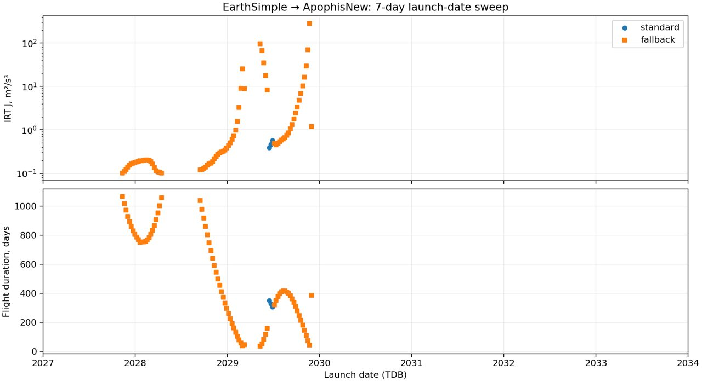

# Новый ранний sweep Апофиса: ApophisNew

366 дат, 01.01.2027–31.12.2033, шаг 7 суток; фактическая последняя точка 30.12.2033. Горизонт 1095,75 суток. Рассчитано 79 кандидатов; принято 79 ИРТ на 79 датах: 3 основным маршрутом, ещё 76 после переключения координат. На 287 датах начальный каталог не дал кандидата в горизонте.

Обе орбиты кеплеровы: EarthSimple и послевстречный набор ApophisNew (эпоха 01.05.2029). ApophisNew используется на всём интервале, включая распространение назад; это ранняя модель целевой орбиты, а не фактические эфемериды Апофиса до встречи. Переход к полным эфемеридам в этой серии не выполнялся.

Вход: дата → фаза → положительные λ(k), |k|≤5 → длительность КЛО → согласование ILTT → ИРТ. k — индекс расслоения. Первоначальная оценка и принятая длительность не превышают трёх лет. Каталог и начальный фильтр могут пропустить другие корни: минимум выбирается только среди проверенных кандидатов на каждой дате, глобальный минимум не заявляется.

Сохранена граница R ±0,598199639. После отказа основной цепочки применяется существующий coordinate_matrix: отдельные режимы ILTT и сопряжённых, по 20 секунд / 70 итераций; при отказе согласования берётся непроверенное приближение той же выбранной по дате ветви. Его принятие как ИРТ требует независимого интегрирования и аудита границ. Коррекция ИРТ фиксирует выведенную длительность; обратного подбора λ по времени нет.

Расчёты выполнены в Docker. ИРТ безмассовая: J=½∫|u|²dt в м²/с³. Метаданные аппарата 204/140 кг, два СПД-50М сохранены только для последующей цепочки; ограничений массы, тяги и топлива в ИРТ нет. Начальная скорость равна скорости Земли. Добавочный импульс, Пазов, ПСИ и оптимизация свободной длительности не выполнялись. Все принятые результаты повторно независимо проверены, включая выбранные источники орбит.

## Самые дешёвые принятые даты

| Старт TDB | Длительность, сутки | J, м²/с³ | Маршрут |
|---|---:|---:|---|
| 2028-04-14 | 1056.730 | 0.100921578 | fallback costates |
| 2027-11-12 | 1065.812 | 0.102102318 | fallback costates |
| 2028-04-07 | 1002.883 | 0.104590522 | fallback costates |
| 2028-03-31 | 952.670 | 0.108279915 | fallback costates |
| 2027-11-19 | 1016.422 | 0.109231777 | fallback costates |
| 2028-03-24 | 907.110 | 0.11512467 | fallback costates |
| 2028-09-15 | 1037.108 | 0.118981619 | fallback costates |
| 2027-11-26 | 971.082 | 0.122796159 | fallback costates |
| 2028-09-22 | 977.786 | 0.123094531 | fallback costates |
| 2028-09-29 | 918.790 | 0.128930443 | fallback costates |
| 2028-03-17 | 866.950 | 0.134759645 | fallback costates |
| 2027-12-03 | 929.817 | 0.138922098 | fallback costates |
| 2028-10-06 | 860.616 | 0.139877374 | fallback costates |
| 2027-12-10 | 892.648 | 0.152902796 | fallback costates |
| 2028-10-13 | 803.658 | 0.153824623 | fallback costates |

[Все 366 дат, включая отсутствие кандидатов и отказы](../data/benchmarks/apophis_new_early_sweep_2027_2033_v1/dates.csv). [Результаты и независимые проверки](../data/benchmarks/apophis_new_early_sweep_2027_2033_v1/final_results.json).

## Воспроизведение

`docker compose run --rm -T -e OPENBLAS_NUM_THREADS=1 -e OMP_NUM_THREADS=1 pipeline sweep-irt configs/apophis_new_early.json --design configs/apophis_early_sweep_2027_2033.json --output runs/<new>`

Дополнительные переключения и сборка отчёта: архив source/. Полные первичные результаты оставлены в runs/apophis_new_early_sweep_2027_2033_v1. Старый sweep не перезаписан; его семь ИРТ получены на другом источнике орбит и автоматически в новую серию не включались.
