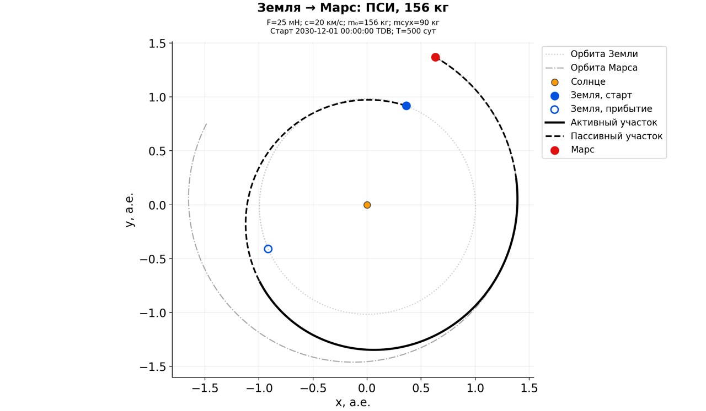
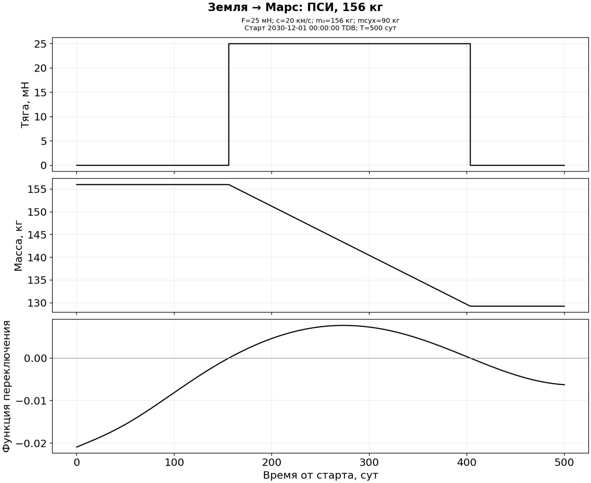

# Земля–Марс: старт в декабре 2030 года

Этот пример содержит только межпланетную часть с согласованием состояния
с центром Марса. Выход на орбиту рассчитан отдельно с пересчётом границы
перелёта: [перелёт и скрутка 400 × 30 000 км](mars_dec2030_capture.md).

Для примера выбран старт **1 декабря 2030 года, 00:00 TDB**.
Это один запуск общего пайплайна с прежними настройками, без поиска даты
или подбора двигателя. Режим — встреча: согласуются положение и скорость Марса.
Общая цель проекта и прежний диагностический контейнер остаются на паузе.

| Параметр | Значение |
|---|---:|
| Длительность | 500 суток |
| Прибытие | 14 апреля 2032 года, 00:00 TDB |
| Начальная масса | 156 кг |
| Сухая масса | 90 кг |
| Постоянная тяга | 25 мН |
| Скорость истечения | 20 км/с |
| Ограничение начального v∞ | 3 км/с |
| Полученный v∞ | 2.659704 км/с |
| Расход на участке малой тяги | 26.746428 кг |
| Конечная масса | 129.253572 кг |
| Численная невязка положения при независимом пересчёте | 0.259 м |
| Численная невязка скорости | 3.66e-8 м/с |

Получена полная ПСИ: β=1, α=1, заданный аппаратный предел, переменная масса,
точные активные/пассивные дуги. Эфемериды и динамика — гелиоцентрическая модель
проекта. v∞ задан как отдельное условие отправления; расход импульсного
разгона до него не входит в приведённые 26.746428 кг.

Двигатель выключен на сутках 0–155.895 и 403.547–500;
на участке 155.895–403.547 суток работает с тягой 25 мН.
Независимый пересчёт LSODA, баланс массы, переключения, параметры запроса
и сверка уравнений/управления с неизменённым Fortran KIAM пройдены.
Это проверенная экстремаль в указанной модели; глобальный минимум не доказан.





Конфигурация: `configs/earth_mars_2030_dec01_500d.json`.
Первичные результаты и checkpoints:
`data/benchmarks/examples/earth_mars_2030_dec01_500d/`.
SHA256 исходных SI-массивов:
`2263c47610d7aa2abb761219c2d91526c1d06b06e823ec74f8a5083881ec5d24`.
Файлы графиков и их контрольные суммы: `mars_dec2030/manifest.json`.

Повторная отрисовка без расчёта:

```powershell
docker compose run --rm pipeline render data/benchmarks/examples/earth_mars_2030_dec01_500d/final --output runs/mars_dec2030_redraw
```

Повторный расчёт с теми же параметрами, в новый каталог:

```powershell
docker compose run --rm pipeline solve configs/earth_mars_2030_dec01_500d.json --output runs/mars_dec2030_repeat
```
