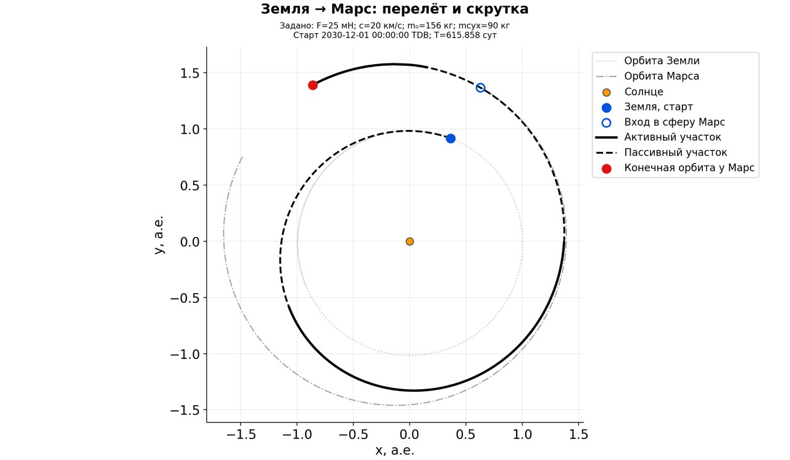
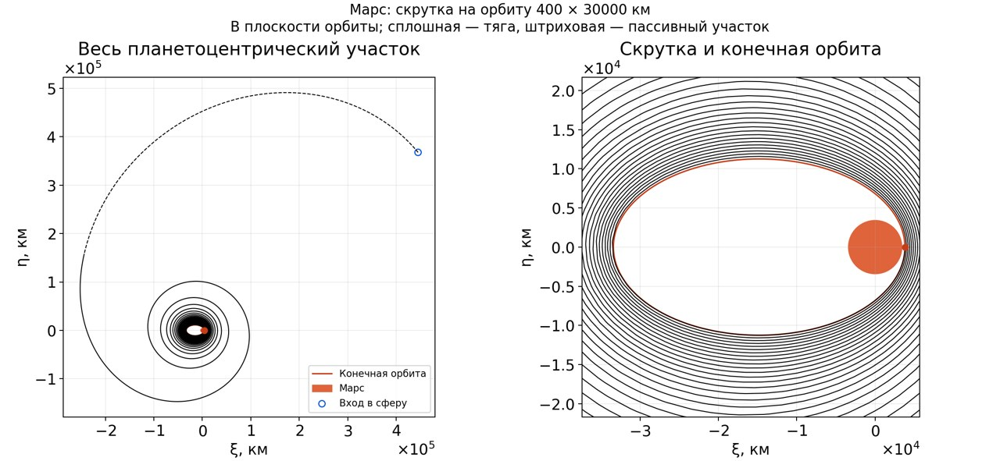
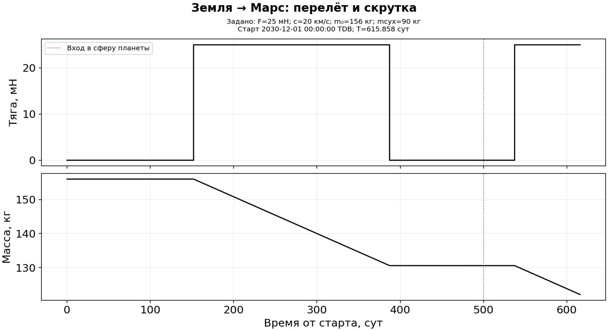

# Земля–Марс: перелёт и скрутка на орбиту 400 × 30 000 км

Старт 1 декабря 2030 года, 00:00 TDB. Пользователь задал высоты перицентра
400 км и апоцентра 30 000 км. Плоскость примера — орбитальная плоскость Марса,
движение прямое; долгота перицентра свободна. Аппарат: 156 кг, сухая масса
90 кг, постоянная тяга 25 мН и скорость истечения 20 км/с.

| Часть | Длительность, сут | Расход, кг | Масса в конце, кг |
|---|---:|---:|---:|
| Межпланетный участок до границы Марса | 500 | 25.410799 | 130.589201 |
| Пассивный участок у Марса | 37.309852 | 0 | 130.589201 |
| Скрутка с непрерывной поперечной тормозящей тягой | 78.548544 | 8.483243 | 122.105959 |
| Вся цепочка | 615.858397 | 33.894041 | 122.105959 |

Вход в окрестность Марса: 14 апреля 2032 года, 00:00 TDB.
Выход на конечную орбиту: **7 августа 2032 года, 20:36:05 TDB**.
Полученный начальный v∞ — 2.219127 км/с при ограничении 3 км/с.
Расход импульсного отправления до этого v∞ не включён.







## Что исправлено в цепочке

Прежний результат согласовывал состояние КА с центром Марса. Он остаётся
проверенным межпланетным примером, но не содержит выхода на орбиту.
При добавлении захвата общий контроллер теперь:

1. Строит скрутку назад от заданного эллипса с постоянными F, c и переменной массой.
2. Добавляет кеплеров пассивный участок от апоцентра на границе до начала тяги.
3. Поворачивает весь планетоцентрический участок в заданную плоскость,
   располагая вход на солнечной стороне.
4. Заново решает физическую межпланетную ПСИ до ненулевого относительного
   положения и скорости на границе. Старый пример используется только как приближение.
5. Согласует оставшуюся массу скалярным поиском. Здесь потребовалось семь
   оценок; невязка массы −6.92e-10 кг.
6. Интегрирует скрутку вперёд от фактического конца межпланетного участка,
   объединяет состояния с движущимся Марсом и проверяет всю композицию.

Это общие модули `planetary_capture.py` и `capture_pipeline.py`, доступные через
тот же `solve`, а не отдельный марсианский решатель. Контроллер сохраняет фазу
остановки и различает согласование, распространение, бюджет и финальную проверку.
Возобновление после согласования массы не повторяет успешно найденный перелёт.

## Проверки и область применимости

Граница — 577 230.384 км от центра Марса: лапласова сфера, вычисленная по
оскулирующей большой полуоси Марса на дату входа, с тем же μ Солнца.
На границе относительная скорость 205.350 м/с, радиальная скорость практически
нулевая. Это вход в апоцентр связанной планетоцентрической орбиты. Выбор
апоцентра/солнечной стороны — явно ограниченная геометрия текущего общего
метода; произвольные гиперболические входы он пока не рассчитывает.

Высоты отсчитываются от экваториального радиуса 3396.19 км, μ Марса
42828.375662 км³/с². Источник констант — сохранённый заголовок Horizons
`data/ephemerides/validation/mars_horizons.txt`.

Скрутка использует прежний закон `integrate_equinoctial.m`, control_type=2:
постоянная поперечная тормозящая тяга. Исторические закон мощности и
эмпирический множитель массы 1.3 не переносились в новую модель двигателя.

Результаты проверок:

- Непрерывность координат, скорости и массы на стыке: 0 в сохранённых массивах.
- Независимый пересчёт межпланетной части LSODA: ошибка положения 0.732 м,
  скорости 1.07e-7 м/с. Сверка с неизменённым Fortran KIAM пройдена.
- Конечные высоты: 399.999910 и 29 999.999899 км; ошибка радиусов ≤0.102 м.
- Повторный независимый пересчёт скрутки LSODA: максимальная разница
  1.117 м и 0.000738 м/с. Начальное обратное построение использует DOP853
  и другую запись поперечного направления.
- Баланс расхода скрутки по F/c: ошибка 2.65e-11 кг; сухая масса соблюдена.
- Состав общей траектории проверен по времени, координатам, скорости, массе,
  тяге и SHA256 исходных участков. На сохранённой сетке перелёта минимальное
  расстояние до Марса достигается на конечной границе.

Отдельно зафиксирован программный сбой в общем тестовом процессе:
`IndexError: arrays used as indices must be of integer (or boolean) type`
внутри вызова `np.dot` при пересчёте намеренно испорченного результата.
Причина не установлена; это не несходимость физической постановки.
Верификатор теперь сначала отклоняет несогласованную композицию, затем
запускает численный пересчёт. Такая проверка входа не считается исправлением
неустановленной причины численного сбоя. Журнал сохранён в архиве.
После изменения порядка проверки все 41 тест прошли в Docker; отдельно
повторно прошли четыре теста модуля захвата на окончательной версии кода.

Модель — сопряжённые центральные поля Солнца и Марса. Солнечные возмущения
внутри сферы Марса, J2, тень и другие тела не включены; особенно у границы
сферы это приближение требует дальнейшей проверки. Непрерывность ускорения
не предполагается. Скрутка задана законом управления и не является решением
совместной задачи глобальной оптимизации перелёта и захвата.

Существующие широкие серии проверяли межпланетную ПСИ. Их доли успеха нельзя
переносить на новый орбитальный модуль: полная сшивка пока проверена на этом
Марсе; отдельно проверен тот же закон скрутки с F=50 мН, c=30 км/с и другой
конечной массой. Это не широкая приёмка модуля захвата.

## Воспроизведение

Конфигурация: `configs/earth_mars_2030_dec01_capture_400x30000.json`.
Первичные массивы, запросы, семь оценок согласования, окружение, снимок кода
и SHA256: `data/benchmarks/examples/earth_mars_2030_dec01_capture_400x30000/`.
Графики SVG/PNG/JPEG и их manifest: `reports/examples/mars_dec2030_capture/`.

```powershell
docker compose run --rm pipeline solve configs/earth_mars_2030_dec01_capture_400x30000.json --output runs/mars_capture_repeat
docker compose run --rm pipeline render data/benchmarks/examples/earth_mars_2030_dec01_capture_400x30000/capture --output runs/mars_capture_redraw
```

Общая цель и прежний диагностический контейнер остаются на паузе.
