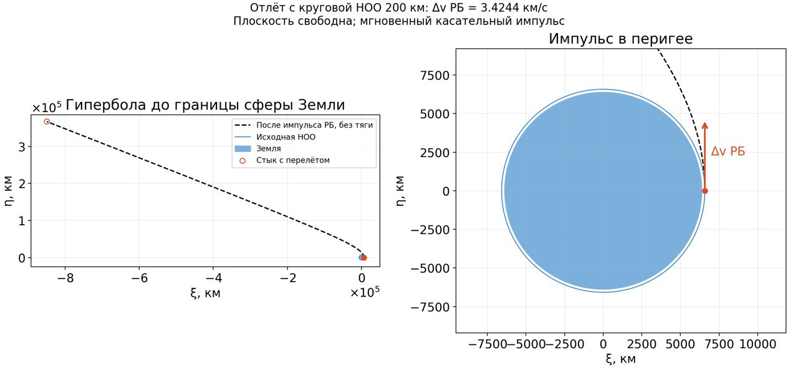
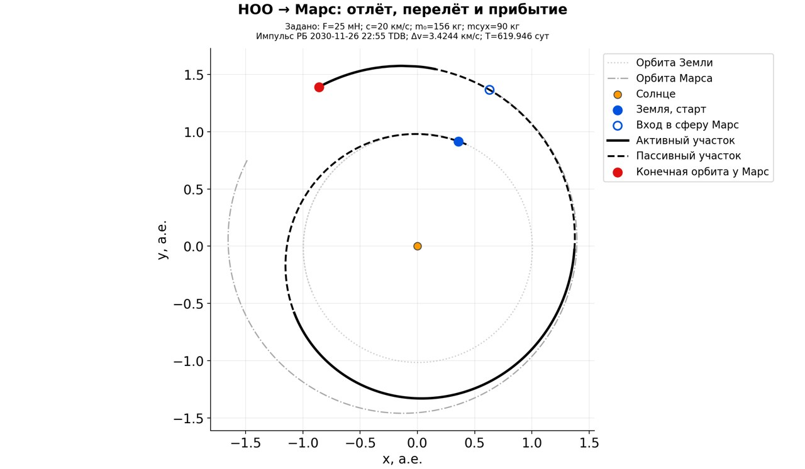
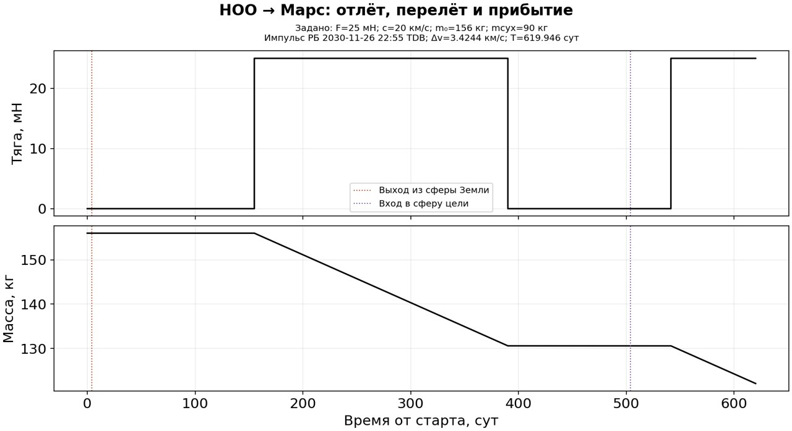

# Отлёт с НОО, межпланетный перелёт и скрутка у Марса

Добавлен общий модуль отлёта с круговой НОО: `parking_departure.py`,
контроллер согласования — `launch_pipeline.py`. Он подключается через прежний
`solve` полем `parking_departure`. Высота — настраиваемый параметр
`parking_altitude_m`; типичное значение по умолчанию 200 000 м.
Плоскость НОО в этом примере свободна по условию пользователя.

Для прежней марсианской постановки пересчитаны внешняя граница Земли,
межпланетный участок и согласование массы скрутки 400 × 30 000 км.
Условия аппарата сохранены: 156 кг после отделения РБ, сухая масса 90 кг,
F=25 мН, c=20 км/с; ограничение истинного v∞ — 3 км/с.

| Величина | Результат |
|---|---:|
| Высота круговой НОО | 200 км |
| Радиус Земли в модели | 6378.137 км |
| μ Земли, как в существующей динамике проекта | 398600.4356 км³/с² |
| Круговая скорость до импульса | 7.784262 км/с |
| Скорость в перигее после импульса | 11.208666 км/с |
| **Требуемая Δv РБ** | **3.424404 км/с** |
| Радиус интерфейса от центра Земли | 924881.552 км |
| Скорость на интерфейсе относительно Земли | 2.303623 км/с |
| Истинный гиперболический избыток v∞ | 2.108253 км/с |
| Пролёт от НОО до интерфейса | 4.045029 суток |
| Невязка положения на стыке | 0.032536 м |
| Невязка вектора скорости | 2.28e-13 м/с |
| Невязка массы КА | 0 кг |

Вектор скорости на интерфейсе в ECLIPJ2000 относительно Земли:
**[−2058.718495, −196.507782, 1014.762148] м/с**. Согласован полный вектор,
а также положение на конечном радиусе; подстановка только модуля v∞
в формулу импульса не заменяет эту сшивку.







## Даты и масса

В новой конфигурации `launch_tdb` сохранён как **эпоха выхода из земной сферы**:
1 декабря 2030 года, 00:00 TDB. Межпланетная длительность 500 суток отсчитывается
от этой границы. Мгновенный импульс на НОО поэтому происходит раньше:
**26 ноября 2030 года, 22:55:09 TDB**. Эти две даты нельзя называть одним стартом.
Если требуется именно декабрьский импульс РБ, нужна новая постановка с другой
эпохой интерфейса и повторным согласованием; она здесь не подменялась молча.

К границе Марса аппарат приходит 14 апреля 2032 года, 00:00 TDB.
Выход на конечную орбиту — 7 августа 2032 года, 21:36:48 TDB.
Расход ЭРДУ на перелёте и скрутке вместе — **33.887452 кг**, масса КА в конце —
**122.112548 кг**. Масса после земного импульса и на выходе из земной сферы —
156 кг: на отлётной гиперболе ЭРДУ выключена.

**Топливо и полная стартовая масса РБ не рассчитывались.** Пока задан идеальный
мгновенный импульс и масса полезной нагрузки после отделения РБ. Для расчёта
топлива РБ нужны его удельный импульс и сухая масса. Приведённые 33.887452 кг
не содержат топливо РБ; число 156 кг не является массой комплекса КА+РБ на НОО.
Δv — требуемое изменение скорости, а не интеграл силы в Н·с.

## Как согласовано

От фактического вектора скорости исправленного межпланетного участка строится
выходящая гипербола с перигеем на заданной НОО. В выбранной свободной плоскости
импульс касательный; круговая скорость до него направлена вдоль скорости в
перигее. Ориентация всей гиперболы обеспечивает заданный вектор скорости у
конечного радиуса. Полученное положение задаёт новую начальную границу
межпланетной ПСИ. После её пересчёта гипербола строится снова.

Здесь потребовалось девять геометрических согласований. Погрешность положения
уменьшилась с 43 568 км до 3.3 см. В каждом согласовании повторно решалась
массовая сшивка с марсианской скруткой; старые расход и конечная масса не
переносились на новую геометрию.

Используются соотношения

```
v∞² = vинтерфейс² − 2 μЗ / Rинтерфейс
vперигей² = v∞² + 2 μЗ / rНОО
ΔvРБ = vперигей − sqrt(μЗ / rНОО)
```

Ограничение `vinf_max_m_s` остаётся ограничением истинного избытка:
в корректоре оно преобразуется в соответствующий предел скорости
на конечном интерфейсе. В метаданных отлётного участка эти две величины
названы отдельно. Радиус интерфейса — лапласова сфера по оскулирующей большой
полуоси Земли на дату выхода, μ Земли и μ Солнца из проекта.

## Проверки и ограничения

Аналитическая гипербола независимо проинтегрирована LSODA: максимальная
разница положения 0.053 м, скорости 1.76e-7 м/с. Проверены круговая орбита
до импульса, направление и величина Δv, энергия, конечный радиус, времена,
полный вектор скорости и масса на стыке. Композиция общей траектории проверяется
по координатам, скорости, времени, массе, тяге, переключениям и SHA256 участков.
Сохранена независимая приёмка межпланетной ПСИ, сверка KIAM и проверка скрутки.

Все **47 тестов** прошли в Docker, включая регрессию сохранения начального
состояния скрутки. Новый модуль также проверен на сохранённых
отлётных векторах четырёх реальных миссий: Марс, Венера, Апофис и Бенну, на
разных датах и для НОО 200/400 км. Это восемь автономных проверок отлётного
модуля и одна полная сшивка; широкой приёмкой всей цепочки они не являются.

Во время итерации `match_05` приёмка скрутки остановилась на различии повторного
пересчёта 0.011885 м/с при допуске 0.01 м/с. Установлен конкретный дефект:
интерполяция решения на t=0 и обратное преобразование единиц меняли исходное
состояние на 9.31e-10 м и 1.42e-14 м/с. Длинная скрутка усиливала эту разницу.
Теперь первая точка сохраняется точно из входного состояния, без интерполяции.
На этом же остановившемся участке два повторных пересчёта совпали точно;
допуски сохранены. Возобновление использовало принятые численные checkpoints,
прошедшие части заново не оптимизировались. Этот исправленный дефект не
объясняет ранее зарегистрированные TypeError/IndexError общего процесса.

Модель отлёта — центральное поле Земли до интерфейса и Солнца после него.
Не включены конечная длительность включения РБ, его массовая модель, J2,
земная тень, солнечные/лунные возмущения у Земли, ограничения космодрома и
фиксированное наклонение НОО. Ускорение на границе центральных моделей
может меняться скачком. Совместный глобальный оптимум всех трёх частей
не доказан; это проверенная сшивка с принятой геометрией.

## Файлы

- Конфигурация: `configs/earth_mars_2030_dec01_leo200_capture.json`.
- Массивы, запросы, все итерации, сохранённая остановка, окружение, снимок
  модулей и manifest SHA256:
  `data/benchmarks/examples/earth_mars_2030_dec01_leo200_capture/`.
- Графики SVG/PNG/JPEG: `reports/examples/mars_dec2030_leo200/`.

```powershell
docker compose run --rm pipeline solve configs/earth_mars_2030_dec01_leo200_capture.json --output runs/mars_leo_repeat
docker compose run --rm pipeline render data/benchmarks/examples/earth_mars_2030_dec01_leo200_capture/launch --output runs/launch_redraw
```

Предыдущие примеры и широкие серии сохранены отдельно. Общая прежняя цель
и диагностический контейнер Цереры не возобновлялись.
