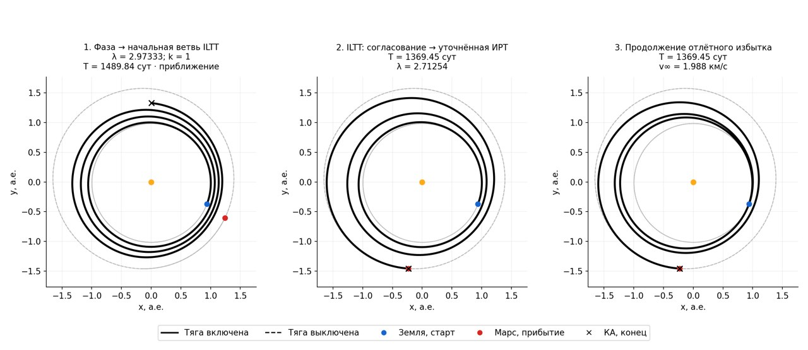
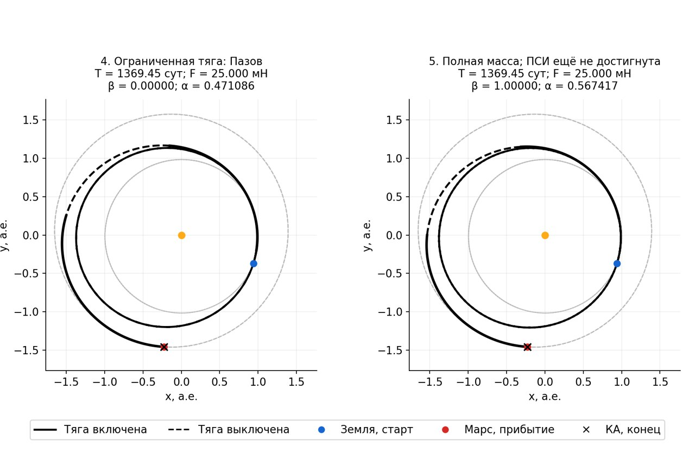

# Марс 2029: восстановлен вход ILTT по дате

11 ноября 2026. Все расчёты и проверки выполнены в Linux Docker.

Вход центрального межпланетного расчёта исправлен: **дата старта → синодическая
фаза → ветви угловой дальности → преобразования ILTT и согласование цели →
длительность**. Исходный сценарий `ILTT/transfer_legacy.py` сохранён из прежнего
проекта; используются `a_OM`, `make_F_function`, R-преобразования и согласование
орбитальных элементов и фазы. Цель обновляется по локальным эфемеридам на каждую
полученную дату прибытия. Перевод нормированного времени сделан через реальные
масштабы пайплайна, без встроенного в старый toolbox жёсткого перевода из а.е.

`tof_days` теперь можно не задавать. В режиме `date` прежнее значение этого
поля не определяет λ. В тесте задания без длительности и с 360 сутками дают
одинаковый результат ILTT. Фильтр длительности проверяет полученный результат,
а не обращает зависимость. Старый режим явно называется `fixed_time`.

В графе `angular_branches` заменяет ось `duration_factors`; последующие границы
освобождения времени считаются от **полученной длительности соответствующей
ветви**. Исторические опоры без нужного происхождения не подменяют новый вход.
Старые дизайны с `duration_factors` сохранены как явный фиксированный режим.

## Проверка одной даты, двух ветвей

Постановка: Земля → Марс, сближение с выравниванием скорости, старт
**2029-09-01 TDB**, масса 156 кг, сухая масса 90 кг, **25 мН / 20 км/с**,
отлётный избыток не более 3 км/с. Длительность во входном JSON отсутствует.
Ни дата, ни двигатель, ни массы между ветвями не менялись.

Синодическая фаза Марса относительно Земли: **−1,306123292 рад**.

| Ветка (ранг) | k | Начальная λ | Уточнённая λ | Полученная длительность | Результат |
|---|---:|---:|---:|---:|---|
| 0 | 1 | 2,973329916 | 2,712536782 | 1369,453818 сут | ИРТ проверена; продолжение дошло до физической массы и тяги, но не точной ПСИ |
| 1 | 2 | 6,632833160 | 6,115102865 | 3401,372862 сут | ИРТ отвергнута независимым пересчётом: 2481,88 м при допуске 1000 м |

Ветка 0 начинается приближением ILTT с длительностью **1489,844957 сут**.
Это ещё не согласованная встреча: конечная точка КА на первом графике отличается
от положения Марса. После согласования параметров ILTT длительность становится
1369,453818 сут; окончательная пристрелка ИРТ уточняет сопряжённые при уже
полученном времени. Независимая невязка положения ИРТ — **180,30 м**,
скорости — **0,0000199 м/с**. Полный глобальный минимум этим не доказывается.

Продолжение избытка дошло до целевого параметра 1, получив около **1,988 км/с**.
Пазов достиг заданных **25 мН** при β=0 и α=0,471086.
Последний проверенный результат холодной цепочки имеет **β=1**, те же
**25 мН / 20 км/с**, α=**0,567416627** и расход **24,554726 кг**.
То есть динамика уже использует реальные массу и двигатель; управление остаётся
сглаженным. Переход к α=1 и точным активным/пассивным дугам не завершён,
поэтому финальная ПСИ не принята и финальная KIAM-приёмка не заявляется.

Дальнейшее освобождение длительности пробовало интервал 958,617673–1780,289963
сут (0,7–1,3 длительности ILTT). Ни одна из пяти проб не прошла коррекцию и
независимую приёмку за 60 секунд. Сохранён исходный проверенный родитель.
Последние причины включают неудачные пробные интегрирования по массе/сближению
с центром и исчерпание бюджетов корректоров; это не свойства принятой траектории.
Граф завершил две особи, три узла, без принятой точной ПСИ. Из-за отказа
освобождения времени ребро дальнейшего физического продолжения в этой серии
не запускалось. Несходимость не означает физическую недостижимость.

## Траектории по этапам

Показаны реальные массивы первой ветви; одинаковый масштаб осей. Чёрный крест —
конец траектории КА, красная точка — Марс на соответствующую дату прибытия.
Начальное приближение ILTT отдельно подписано как приближение.

## Проверки и границы

**101/101 тест Docker** пройден, включая независимый пересчёт ИРТ Марса,
независимость входа по дате от старого значения времени, знак синодической фазы,
ветви графа и отказ по фильтру времени без обратного подбора λ. После усиления
проверок повторного использования разрешённой миссии и сообщений об отказах
весь набор повторно пройден: 101 тест за 84,309 с. Численные формулы серии
при этом не менялись; исходные хеши каждого запуска сохранены в его JSON.

Сохранённые промежуточные артефакты отдельно повторно проверены по их уравнениям,
с аудитом дат, F/c, масс и хешей. Вторая ветвь не принята вопреки малой невязке
собственной пристрелки: независимая интеграция не уложилась в допуск.

Эта проверка относится к Марсу 2029 и двум ветвям. Прежняя широкая серия с
фиксированным входным временем **не является** широкой проверкой исправленного
входа ILTT. Локальные отлёт/захват, УММП и CR3BP здесь не пересчитывались.

Штатный дизайн: `configs/search_graph_date_v3.json`.
[Архив и контрольные суммы](../data/benchmarks/iltt_date_mars2029_v3/manifest.json),
[независимые проверки и диагностика ветвей](../data/benchmarks/iltt_date_mars2029_v3/graph/verified_results.json).
