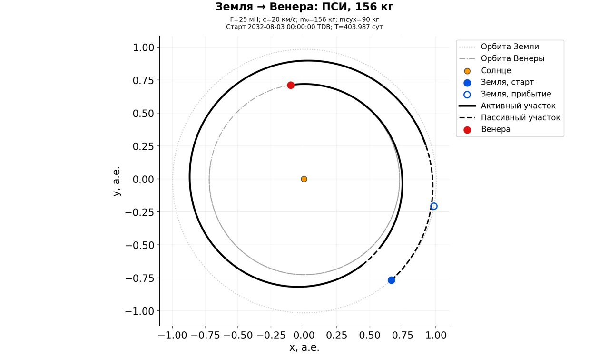
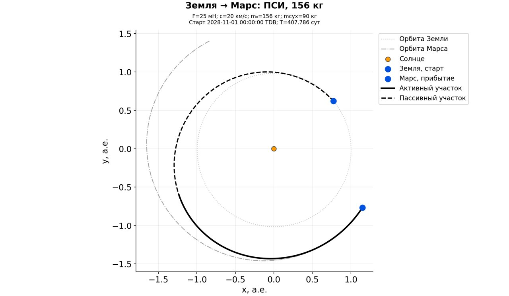
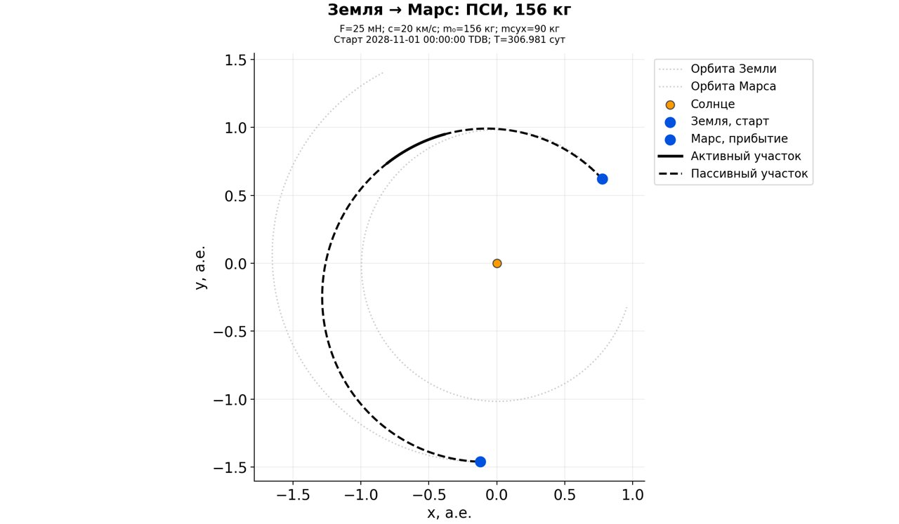
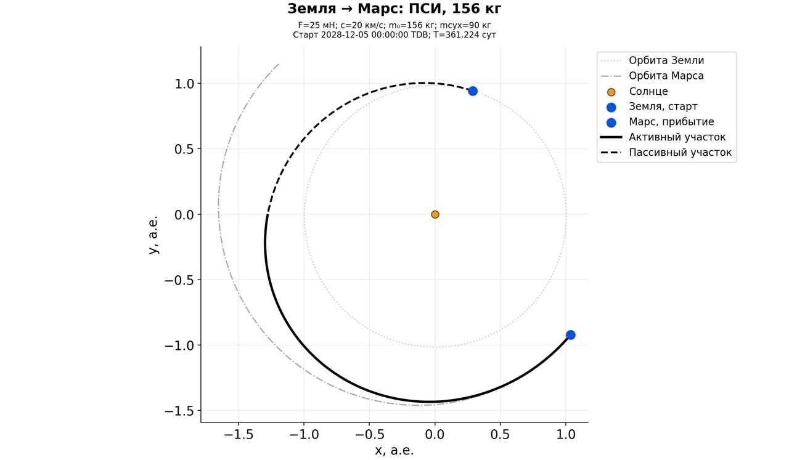

# Свежая широкая проверка входа ILTT

Численные цепочки: коммит `e113b305`, Linux Docker. [Архив входов, массивов,
графов, проверок и SHA256](../data/benchmarks/iltt_fresh_matrix_v4/README.md).
Точная сводка: `snapshot/runs/iltt_fresh_matrix_v4_full/verified_results.json`;
все поиски — `verified_searches.json` рядом. Проверены 70 ИРТ, 257 промежуточных
артефактов и 27 физических узлов из 443 узлов графов.

Проверено 15 постановок; физическая ПСИ найдена в 4, исходные условия сохранены в 2.

Все цепочки начаты заново: дата → фаза → угловая ветвь → ILTT → длительность. Старые решения не импортировались. Массы 156/90 кг, избыток до 3 км/с, допуски 1000 м / 0,01 м/с. Варианты F/c: 25 мН / 20 км/с и 50 мН / 40 км/с.

Общий дизайн: ветви 0/1, даты 0/±90/±180/±270 суток; 8 особей × 2 поколения, seed 17, лимит 4800 с на случай. Время освобождается в границах 0,5–1,5 длительности ILTT конкретной ветви; до двух промежуточных циклов. Принятый физический родитель сохраняется при неудаче финальной оптимизации времени. Это ограниченный поиск, не полный перебор и не доказательство глобального оптимума.

Основной проход нашёл ПСИ для 4 постановок. Отдельно выполнено 12 дополнительных поисков: для каждого случая без ПСИ выбирались до двух согласовавшихся входов с покрытием эфемерид и непроверенными сочетаниями F/c из полной проверки 210 вариантов. Выбор по наименьшему сдвигу даты, затем длительности ILTT; непосещённые варианты из двух прежних двигателей, 1–2 особи × 1 поколение и 1800 с на вход. Это единое дополнение протокола, исходный проход не переписан.

| Постановка | ПСИ | Дата / длительность | F / c | Топливо, кг | Маршрут либо остановки |
|---|---|---|---|---|---|
| earth_venus_2032 | изменены условия | 2032-08-03 / 403.99 сут | 25 мН / 20 км/с | 35.417 | cold |
| earth_mars_2028 | исходные условия | 2028-11-01 / 407.79 сут | 25 мН / 20 км/с | 22.909 | cold → intermediate_release → physical_continue |
| earth_apophis_2029 | пока не найдена | — | — | — | iltt_entry: 10, iltt_entry_unfinished: 2 |
| earth_eros_2029 | пока не найдена | — | — | — | psi: 7, fuel: 12, intermediate_release: 7, iltt_entry: 6, mass_and_thrust: 2, departure: 6 |
| earth_bennu_2029 | пока не найдена | — | — | — | iltt_entry_unfinished: 5, iltt_entry: 6, psi: 1, mass_and_thrust: 2, departure: 6, irt: 2 |
| earth_ryugu_2028 | пока не найдена | — | — | — | iltt_entry: 11, psi: 3, fuel: 4, intermediate_release: 3, mass_and_thrust: 2 |
| earth_polyhymnia_2029 | пока не найдена | — | — | — | psi: 4, mass_and_thrust: 3, fuel: 5, irt: 7, iltt_entry: 2, iltt_entry_unfinished: 1 |
| earth_ceres_2030 | пока не найдена | — | — | — | psi: 6, mass_and_thrust: 8, departure: 15, iltt_entry: 3, fuel: 4, intermediate_release: 1, irt: 1 |
| earth_mercury_2029 | пока не найдена | — | — | — | iltt_entry: 11, psi: 5, mass_and_thrust: 10, intermediate_release: 1 |
| earth_jupiter_2028 | пока не найдена | — | — | — | iltt_entry: 10, iltt_entry_unfinished: 1, irt: 2 |
| venus_earth_2029 | пока не найдена | — | — | — | iltt_entry: 12 |
| earth_mars_flyby_2028 | исходные условия | 2028-11-01 / 306.98 сут | 25 мН / 20 км/с | 2.854 | cold → release |
| earth_2015re36_2028 | пока не найдена | — | — | — | iltt_entry: 11, irt: 4 |
| earth_saturn_flyby_2028 | пока не найдена | — | — | — | iltt_entry: 12 |
| earth_mars_2029 | изменены условия | 2028-12-05 / 361.22 сут | 25 мН / 20 км/с | 25.898 | cold → intermediate_release → physical_continue → intermediate_release → physical_continue |

## Принятые альтернативы условий

Основная таблица предпочитает меньшую перемену условий, затем расход. Ниже для каждой принятой пары «дата / двигатель» выбран наименьший расход среди сохранённых узлов; это не доказательство глобального минимума.

| Постановка | Старт | F / c | Длительность, сут | Топливо, кг |
|---|---|---|---:|---:|
| earth_venus_2032 | 2032-05-05 | 25 мН / 20 км/с | 569.906 | 28.6132 |
| earth_venus_2032 | 2032-08-03 | 25 мН / 20 км/с | 403.987 | 35.4167 |
| earth_venus_2032 | 2032-11-01 | 50 мН / 40 км/с | 241.655 | 14.0459 |
| earth_mars_2028 | 2028-08-03 | 25 мН / 20 км/с | 634.936 | 26.5324 |
| earth_mars_2028 | 2028-11-01 | 25 мН / 20 км/с | 407.786 | 22.9088 |
| earth_mars_2028 | 2028-11-01 | 50 мН / 40 км/с | 364.758 | 12.0927 |
| earth_mars_flyby_2028 | 2028-05-05 | 25 мН / 20 км/с | 720.702 | 2.7242 |
| earth_mars_flyby_2028 | 2028-08-03 | 25 мН / 20 км/с | 695.317 | 5.5787 |
| earth_mars_flyby_2028 | 2028-11-01 | 25 мН / 20 км/с | 306.981 | 2.8543 |
| earth_mars_flyby_2028 | 2028-11-01 | 50 мН / 40 км/с | 306.957 | 1.4299 |
| earth_mars_2029 | 2028-12-05 | 25 мН / 20 км/с | 361.224 | 25.8976 |

Отдельная диагностика: 1 принятых результатов финального release имеют больший расход, чем их физический родитель. Успех локального оптимизатора не означает фактического улучшения. Родители сохранены; таблицы сравнивают все принятые узлы, а не автоматически выбирают последний.

Для каждого отказа точная причина, модель и посещённые даты/ветви находятся в verified_results.json / verified_searches.json и graph.json соответствующего случая. Несходимость, истечение бюджета и недостаток покрытия не доказывают физическую недостижимость. Приёмка относится к центральному межпланетному участку с постоянными F/c; локальные манёвры и УММП этой серией не проверялись.

## Что выявила перепроверка

1. Начальный ILTT остаётся отдельным ограничением. Из [210 вариантов даты и
   угловой ветви](iltt_preflight_v4.md) согласовались 75. У Апофиса, Сатурна
   и Венера → Земля ни один из этих входов не согласовался в заданных пределах.
   Это не доказательство отсутствия соответствующей траектории. Выражения
   с log(κ) плохо обусловлены около κ=1; опорные аппроксимации сопряжённых
   используют κ=0,72 и 1,52. Полнота каталога ветвей не доказана.
2. Для Цереры есть согласованные входы и проверенные промежуточные модели,
   но физическая ПСИ не получена. Дополнительно проверены сдвиги −90 суток
   (ветвь 0, недостающий двигатель 50 мН / 40 км/с) и +90 суток (ветвь 1,
   оба двигателя); длительности ILTT около 1252,5 и 2059,8 суток.
   Остановки происходили на избытке, продолжении массы/тяги и точной ПСИ.
3. Освобождение времени до физической ПСИ оказалось необходимо для принятых
   маршрутов Марса. Для сентябрьской постановки 2029 исходная дата не решена;
   решение найдено с переносом на 05.12.2028. Это не январский контроль.
4. Финальное освобождение времени само по себе не гарантирует меньший расход.
   Один принятый узел оказался хуже физического родителя; родитель сохранён,
   выбор отчёта сравнивает все принятые узлы. Глобальная оптимальность не доказана.

Оба поиска Венеры 2032 и Марса 2029 достигли основного лимита времени,
сохранив принятые решения. Остальные остановки также следует читать с учётом
бюджета; это не исчерпывающий перебор всех допустимых условий.

## Контроли обычного запуска и данных

Обычный `solve` на Земля → Марс 01.01.2029 заново прошёл короткую ветвь,
два промежуточных освобождения времени, продолжение к ПСИ и финальную
оптимизацию: 352,049928 суток, 37,540653 кг топлива, конечная масса
118,459347 кг, невязки 0,214516 м и 3,70·10⁻⁸ м/с. Независимый пересчёт
и KIAM пройдены. После исправления диспетчера результат воспроизведён
в `iltt_dispatch_checked_v4`; его точные наложенные исходники сохранены
в `reproduce/reporting_dispatch_v4`. Этот контроль не входит в 15 строк.

Принудительный возврат быстрого sweep в стандартный режим действительно
начал ILTT от даты, но при более широком интервале времени остался на
продолжении массы/тяги. Исправление маршрутизации подтверждено; успешная
физическая ПСИ для этой конкретной попытки не заявляется.

Обработка раннего отказа ILTT теперь сохраняет отчёт с `phase=iltt_entry`.
Сохраняется сырой запрос с `tof_days=null`, а границы времени назначаются
после ILTT. Возобновление с изменёнными CLI-параметрами запрещено.
После интеграции прошла 21 адресная проверка в Docker; полный набор не запускался.

[Локальные эфемериды расширены до 2020–2080](ephemerides_2020_2080.md),
включая уточнение интерполяции вблизи встреч. Все контрольные пробы уложились
в 100 м / 0,001 м/с. Это проверка интерполяции, не точности долгосрочного
предсказания орбит. Прежняя пилотная серия на старом покрытии исключена из итогов.

## Траектории выбранных решений

