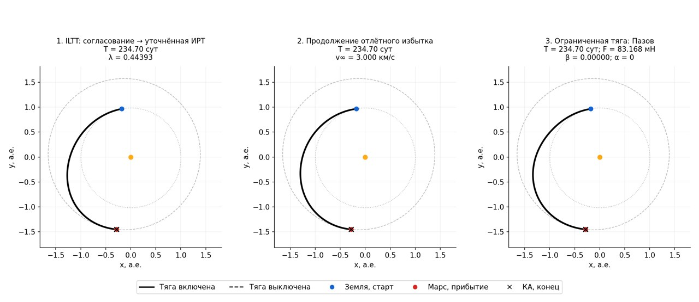
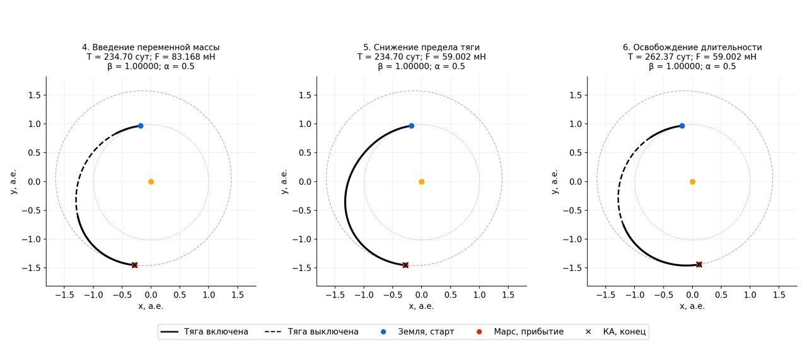
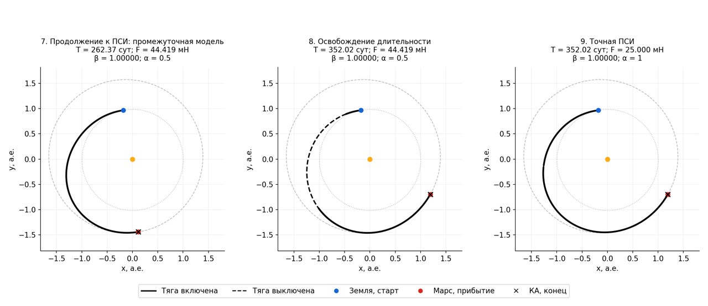

# Короткая ветвь Земля → Марс 01.01.2029 доведена до точной ПСИ

Расчёт в Linux Docker, без полного набора тестов. Итог принят независимым
пересчётом, аудитом параметров и KIAM. Это межпланетное сближение с Марсом
с выравниванием скорости; локальный захват на орбиту не включён.

| Параметр | Принятый результат |
|---|---:|
| Старт | 2029-01-01 TDB |
| Прибытие | 2029-12-19 00:35:02 TDB |
| Длительность | 352,024331 суток |
| Тяга / скорость истечения | 25 мН / 20 км/с |
| Начальная / сухая масса | 156 / 90 кг |
| Расход топлива | 37,550680 кг |
| Конечная масса | 118,449320 кг |
| Отлётный избыток | 3,000 км/с |
| Невязка положения | 0,269806 м |
| Невязка скорости | 4,095 × 10⁻⁸ м/с |
| Модель | α=1, β=1, точные переключения тяги |

Дата, двигатель, массы, тип встречи и ограничение избытка не менялись.
Менялась длительность: **234,699952 → 262,369701 → 352,024331 суток**.
Начальная короткая ветвь ILTT имеет λ₀=0,533484, после согласования λ=0,443926.
Фактический угловой проход конечной ПСИ в проекции XY — 0,636487 оборота;
дополнительного полного витка нет. Это измерение траектории, а не повторная
оценка параметра аппроксимации λ.

## Маршрут

1. Дата → фаза → короткая аппроксимация ILTT → согласование движущегося Марса.
2. Уточнённая ИРТ на 234,70 суток: независимая невязка положения 1,94 м.
3. Продолжение отлётного избытка до разрешённого ограничения 3 км/с.
4. Пазов: при фиксированных 234,70 суток снижение предела остановилось на
   искусственных 83,168 мН. Затем введена полная масса и предел снижен до
   59,002 мН. Эти модели не принимались за физическую ПСИ заданного двигателя.
5. Первое освобождение длительности до 262,37 суток и продолжение до
   44,419 мН. Двигатель постановки оставался 25 мН.
6. Второе освобождение до 352,02 суток. Последующее продолжение достигло
   заданных 25 мН, β=1, α=1 и точных активных/пассивных дуг.

Оба освобождения использовали одинаковые границы: 0,5–1,5 исходной длительности
ILTT, то есть 117,349976–352,049928 суток. Итог находится близко к верхней
границе. Оптимальность длительности вне этого интервала не утверждается;
после достижения точной ПСИ дополнительной оптимизации времени не выполнялось.

## Траектории по шагам

Оси и масштаб одинаковы. Сплошная чёрная линия — тяга включена,
штриховая — выключена; крест — конечная точка КА, красная точка — Марс.

## Проверки и воспроизведение

Повторно проверены итоговая ПСИ и все девять показанных этапов по их собственным
уравнениям. У финала отдельно проверены аппаратные F/c, α=β=1, масса, дата
старта, ограничение избытка, граничные невязки и KIAM. Полная тестовая сюита
не запускалась по поручению пользователя.

Начальный проход: `docker compose run --rm -T pipeline solve
runs/mars_short_psi_request.json --fixed-time --output runs/mars_short_psi_v1`.
Здесь `--fixed-time` запрещает последующее освобождение **в этом проходе**;
длительность всё равно получена через новый вход ILTT, а не задана вручную.
Затем `reproduction/continue_short_psi.py` дважды вызывает штатные операции
`intermediate_release` и `physical_continue` от проверенного родителя.
Без этого явного режима первый вызов CLI обнаружил отдельный дефект:
построение стандартных временных границ из отсутствующего `tof_days`.
Этот дефект CLI не исправлялся в рамках данного расчёта; успешный маршрут
воспроизводится приведённой командой и сохранённой оркестрацией.

Архив содержит оба прохода продолжения, журналы неудачных проб, исходный запрос,
массивы и метаданные всех этапов, скрипты воспроизведения и графики. Пути `runs/`
внутри JSON — исходное происхождение, не перемещённые ссылки.

[Итоговая ПСИ](../data/benchmarks/mars_short_psi_2029jan01/final/trajectory.json),
[проверки и условия](../data/benchmarks/mars_short_psi_2029jan01/summary.json),
[контрольные суммы](../data/benchmarks/mars_short_psi_2029jan01/manifest.json).
