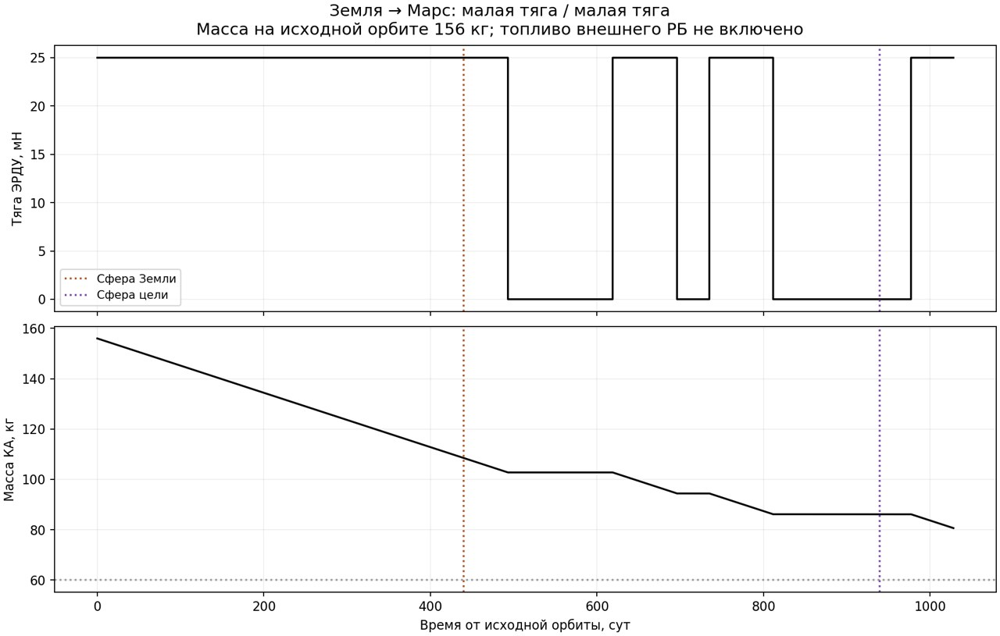
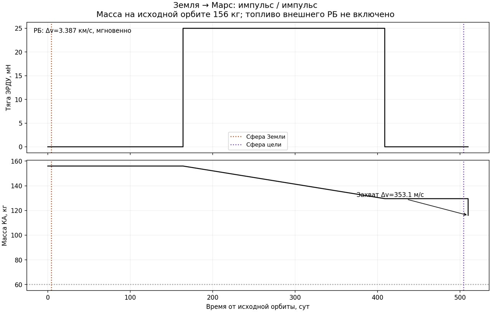

# Четыре сочетания отлёта и прибытия

Реализован общий контроллер `orbital_pipeline.py` с независимым выбором
`orbital_maneuvers.departure.kind` и `arrival.kind`: `spiral` либо `impulse`.
Приёмка выполнена в Linux Docker с неизменённым KIAM Astro 6.1.6.

По уточнению пользователя **156 кг относится к исходной НОО**, а скорость
истечения двигателя импульсного захвата — **3200 м/с**. На раскрутке масса
уменьшается; межпланетная ПСИ получает фактический остаток. Топливо захвата
перевозится вместе с КА. Внешний РБ остаётся отдельной ступенью: его топливо
и полная масса не включены в массовую модель полезной нагрузки.

## Условия двух отдельных матриц

Все восемь запусков используют НОО 200 км со свободной плоскостью,
F=25 мН, c ЭРДУ=20 км/с, выход из земной сферы 01.12.2030 00:00 TDB,
500 суток межпланетного участка и конечную орбиту Марса 400 × 30 000 км.
Для импульсного захвата задан один и тот же входящий избыток **1000 м/с**;
это явный параметр проверочной постановки, не найденный оптимум.

- **dry90:** прежняя сухая масса 90 кг, 2 завершения / 2 частичных пути.
- **dry60:** отдельная контрольная сухая масса **60 кг для всех четырёх
  режимов**, 4 завершения / 4. Это проверка реализации на другом объявленном
  аппарате, а не успешный пересчёт прежнего аппарата под прежним именем.

Никаких изменений F/c, дат, длительности или допусков под отдельные строки
не делалось. Режимы определяют разные локальные граничные состояния и
разные расходы, поэтому внешняя ПСИ решается заново.

## Полные сшивки контрольной матрицы dry60

| Отлёт | Прибытие | Масса на земной сфере, кг | Конечная масса, кг | Топливо КА, кг |
|---|---|---:|---:|---:|
| Импульс РБ | Импульсный захват | 156.000000 | 116.039423 | 39.960577 |
| Импульс РБ | Скрутка | 156.000000 | 122.112548 | 33.887452 |
| Раскрутка | Импульсный захват | 108.512643 | 75.605719 | 80.394281 |
| Раскрутка | Скрутка | 108.512643 | 80.628672 | 75.371328 |

Топливо в таблице — расход самого КА: раскрутка + перелёт + захват.
Расход РБ в сравнение не включён. При импульсном захвате Δv≈353.063 м/с:
его расход равен 13.535896 кг после импульсного отлёта и 8.819341 кг после
раскрутки из-за различной массы перед включением.

Раскрутка расходует **47.487357 кг** за **439.697750 суток**. При сохранённой
эпохе выхода из земной сферы она начинается **17.09.2029 07:15 TDB**.
Импульс РБ происходит 26.11.2030: около 15:49 TDB для импульсного захвата
и 22:55 TDB для скрутки. Длительности прибытия — 5.530685 суток до импульса,
115.900550 суток скрутки после РБ и 88.237787 суток скрутки после раскрутки.
Эти дополнительные длительности не скрыты внутри 500 суток перелёта.





## Исходная сухая масса 90 кг

| Отлёт | Прибытие | Результат |
|---|---|---|
| Импульс РБ | Импульсный захват | Завершён, конечная масса 116.039423 кг |
| Импульс РБ | Скрутка | Завершён, конечная масса 122.112548 кг |
| Раскрутка | Импульсный захват | Частично: введение массы ПСИ, бюджет, β=0.999609375 |
| Раскрутка | Скрутка | Частично: введение массы ПСИ, бюджет, β=0.999609375 |

Точные остановки находятся в
`match_00/seed_chain/stage_psi/mass/continuation.json` соответствующих строк.
При β<1 это промежуточная модель, не готовый физический расход. Финальные
решения контрольного аппарата после раскрутки имеют массу ниже 90 кг;
переносить их на исходный аппарат нельзя. Два частичных запуска по бюджету
**не доказывают физическую недостижимость** и не выдаются за готовые миссии.

## Реализация и проверки

Раскрутка прямо интегрирует центральное поле, положительную поперечную тягу
и `dm/dt=-F/c`, начиная с круговой орбиты. Первичное построение использует
полярные координаты и угловой момент, независимый пересчёт — угловую скорость
и LSODA. Это не обращённый массив скрутки. На длинном участке максимальная
разница составляет **29.268 м**, **0.000112 м/с** и **3.64e-11 кг**.

Импульсное прибытие строит настоящую входящую гиперболу до перицентра,
после чего записывает событие с полными состояниями до/после, вектором Δv,
временем и массой по ракетному уравнению. `arrival/` хранит дугу до включения,
`final/` заканчивается состоянием после него. Время не дублируется в массиве;
заданный скачок хранится в `impulses.json`. На рисунке скачок массы показан
вертикально, а не как длительный расход ЭРДУ. Состояния события захвата
заданы относительно Марса в осях ECLIPJ2000, в СИ; время события — секунды
от исходной НОО, а календарная эпоха общей траектории явно хранится в TDB.

На обоих интерфейсах проверены координаты, все компоненты скорости,
эпоха и масса. Максимальная невязка положения стыка — **0.028 м**, скорости
<1e-6 м/с и массы <1e-6 кг. Нулевые сохранённые невязки не означают нулевую
ошибку физической модели: независимый пересчёт имеет приведённые выше ошибки.
Максимальная ошибка радиусов конечного эллипса — **0.442 м**.

Внешняя ПСИ в каждом принятом расчёте достигает α=β=1, реальных F/c и проходит
независимый LSODA/KIAM. Состав общей траектории проверяется по времени,
координатам, скорости, массе, тяге, переключениям и SHA256 источников.
Параметры нового запроса связываются с исходной массой и обоими двигателями.

Исправлены три места задания фиксированного начального вектора скорости:
точная стрельба, сглаженная стрельба и начальное приближение коллокации.
Раньше могла сохраняться скорость старого входа. При изменении начальной
трансверсальности контроллер теперь проходит штатную ИРТ → Пазов → ПСИ;
старое число активных дуг не навязывается новой задаче. Развивающие прогоны
и остановки сохранены отдельно, приёмочные матрицы их не включают.

Все **53 теста** прошли в Docker. Отдельно на окончательной версии прошли
6 тестов новых режимов, включая намеренную подмену массы, времени и вектора
импульса с обновлённым SHA256, и подмену двигателя. Валидаторы пяти скилов
также прошли в отдельном одноразовом контейнере; PyYAML потребовался только
валидатору, образ расчёта и KIAM не менялись. Команды `verify-orbital` и
`render-orbital` проверены на сохранённом результате без новой оптимизации.

## Ограничения и воспроизведение

Модель — сопряжённые центральные поля. Включения импульсных двигателей
мгновенные; N-body, J2, тень, космодром и фиксированная плоскость отлёта не
включены. Длительная раскрутка особенно требует последующей проверки
возмущённой динамикой. Управление локальных спиралей задано, а совместная
глобальная оптимальность всей миссии не доказана. Четыре способа на одной
марсианской геометрии не заменяют широкую проверку по телам и эпохам.

Конфигурации — `configs/orbital_modes/`. Первичные данные, запросы,
checkpoints, окружение, снимок исходников, скилы и manifest SHA256 —
`data/benchmarks/orbital_modes_v1/`. Отдельные машинные отчёты:
[dry60](orbital_modes_v1/matrix_dry60.md), [dry90](orbital_modes_v1/matrix_dry90.md).

```powershell
docker compose run --rm pipeline solve configs/orbital_modes/mars_spiral_impulse_dry60.json --output runs/new_orbital_case
docker compose run --rm pipeline verify-orbital data/benchmarks/orbital_modes_v1/dry60/mars_spiral_spiral_dry60
docker compose run --rm pipeline render-orbital data/benchmarks/orbital_modes_v1/dry60/mars_spiral_spiral_dry60 --output runs/orbital_redraw
```

Скил `trajectory-pipeline` и его инструкция планетных интерфейсов описывают
новый выбор режимов и отличия привязки массы от старых конфигураций.
