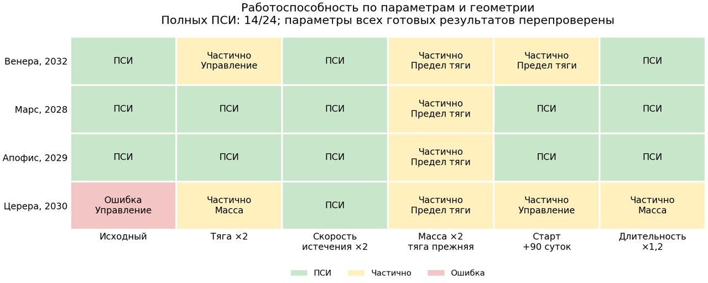

# Общий корректор: результат фиксированной серии

24 прежние постановки, Docker/Linux, одинаковые аппаратные варианты, даты,
допуски и бюджеты. Единственное изменение численного алгоритма — аналитические
производные в общей коллокации. Отдельные строки не перенастраивались.

Итог: **14 полных ПСИ, 9 частичных, 1 ошибка программы**. Ранее было 14/8/2.
Все 14 прежних полных решений сохранены; разность расхода ≤3.98e-13 кг.
Общая сходимость не улучшилась по числу полных решений. Ошибки Венеры сменились
частичными исходами, но исходная Церера завершилась тем же TypeError счётчика
nfev на пути DOP853. Причина не установлена; смена места ошибки не доказывает
её устранение.

Все **688 сохранённых траекторных артефактов** повторно сверены с исходными
запросами; несовпадений параметров нет. Все 14 финалов проходят строгую сверку
F,c,масс,дат и физической модели. Проверки изменения граничной геометрии
соответствуют объявленным вариациям во всех четырёх группах.

Незавершённые случаи сохраняются как границы применимости данного запуска,
без подбора нового двигателя, даты или частного решателя. Девять частичных:
пять на снижении тяги, два на введении массы, два на точном управлении.
Отдельная ошибка Цереры находится на переходе к точному управлению.
Восемь частичных остановились по бюджету этапа, одна — по минимальному шагу.
Это не доказательство физической недостижимости.

Подробности по каждому случаю: [блок и причина остановки](parameter_study_analytic_v1_stops.md),
[полная таблица параметров](parameter_study_analytic_v1.md),
[сравнение с первым проходом](parameter_study_analytic_comparison.md).

Первичные данные и checkpoints: `data/benchmarks/parameter_study_analytic_v1/`
(1777 файлов, 101836303 байта). `source_consistency.json` подтверждает один
набор численных исходников. Документация и тесты менялись отдельно, численные
файлы во время серии оставались зафиксированы. Программные/нативные ошибки
рассматриваются отдельно от допустимой несходимости; подгонка отдельных
случаев не является следующим шагом.
