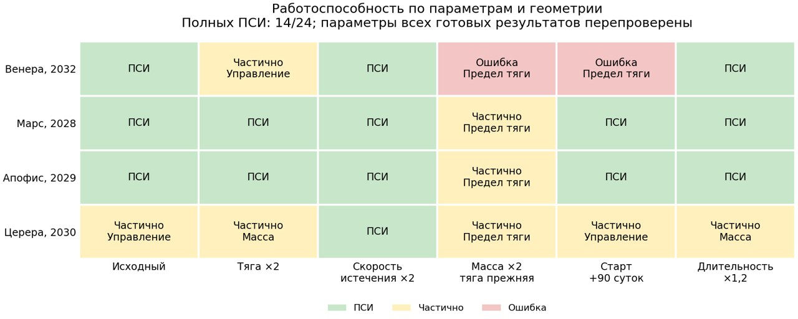

# Двигатель, масса и геометрия: границы общей цепочки

5 ноября 2026. Передача параметров проверена и защищена на стыках модулей.
Равномерная сходимость пока не достигнута: **14 полных ПСИ, 8 частичных путей,
2 ошибки вычисления из 24 постановок**. Частичный путь не доказывает
физическую недостижимость задачи.

## Постановка и результаты

Четыре базовые миссии: Земля–Венера, Земля–Марс, Земля–Апофис,
Земля–Церера. Для каждой применены одинаковые шесть вариантов.
Исходный аппарат: 156 кг, сухая масса 90 кг, тяга 25 мН, скорость истечения
20 км/с. Численные правила и бюджеты одинаковы во всех строках; частные
настройки для отдельных тел не вводились. Луна исключена из целей метода.

| Изменение относительно базы | Полных / всего | Частичных | Ошибок |
|---|---:|---:|---:|
| Исходная постановка | 3/4 | 1 | 0 |
| Тяга 50 мН | 2/4 | 2 | 0 |
| Скорость истечения 40 км/с | 4/4 | 0 | 0 |
| Масса 312 кг, сухая 180 кг; прежний двигатель | 0/4 | 3 | 1 |
| Старт на 90 суток позже | 2/4 | 1 | 1 |
| Длительность ×1.2 | 3/4 | 1 | 0 |

По направлениям: Венера 3/6, Марс 5/6, Апофис 5/6, Церера 1/6.
Увеличение тяги не гарантирует улучшения сходимости данного продолжения.
Снижение F/m при удвоении массы — слабая область текущего метода.
Это не вывод о невозможности любых перелётов аппарата массой 312 кг.

Церера завершена только в общем варианте c=40 км/с; это иной двигатель,
а не решение исходной постановки с c=20 км/с. Успех четырёх случаев с
c=40 км/с не является рекомендацией заменять им неудачные строки.
Две ошибки относятся к Венере: при массе×2 возник
`TypeError: unsupported operand type(s) for +=: 'cell' and 'int'`
в счётчике nfev на пути DOP853; при старте+90 суток произошла нативная
авария процесса с exit code -11. Это уточнено по первичным summary/журналам:
раннее описание обоих отказов как одного TypeError было неточным.
Причина не установлена, сбои не исправлены.
Остальные случаи серии отработали независимо от этих ошибок.



## Что защищает от расчёта с чужими параметрами

`request.json` фиксирует исходный запрос, граничные состояния, эпохи,
длительность, нормировку и контрольные суммы. На стыках ИРТ, продолжения
по избытку, Пазова и ПСИ артефакт сравнивается с этим внешним запросом.
Перед приёмкой финала F и c дополнительно восстанавливаются из коэффициентов
уравнений; проверяются начальная и сухая массы, тяга/ускорение, расход F/c,
точная конечная модель и достижение именно заданного аппаратного предела.
Одного флага готовности или изменённых метаданных недостаточно.

Повторно проверены **681 траекторный артефакт**, включая промежуточные
принятые точки и результаты незавершённых случаев. Несовпадений нет.
Все **14 финалов** соответствуют запрошенным F,c,m₀ и прошли штатную
независимую проверку траектории. Во всех четырёх группах изменение
двигателя/массы сохраняет граничную геометрию; изменение старта меняет оба
состояния тел, изменение длительности — состояние прибытия.

В Docker прошли **30 тестов**: в том числе намеренная подмена F,c,массы,
даты, длительности, ускорения, аппаратного флага, старого resume и входной
матрицы. Некорректные числа и неизвестные параметры двигателя отклоняются.
Равные числа 156 и 156.0 не создают ложного различия конфигураций.
На реальной траектории также проверено масштабирование m₀×2,F×2:
та же геометрия и удвоенный расход, подтверждённые независимым интегрированием.
Это проверка размерностей, не дополнительная оптимизационная строка серии.

## Воспроизводимость и следующий общий шаг

Повторный разбор сохранённых checkpoint выделяет три разных барьера среди
восьми частичных результатов. Параметры ниже относятся к последней принятой
точке, а не к неудачному пробному шагу.

| Барьер | Случаи | Последнее достигнутое значение |
|---|---|---|
| Физический предел тяги после введения массы | Апофис, масса×2 | s=0.372258 |
| То же | Марс, масса×2 | s=0.5375 |
| То же | Церера, масса×2 | s=0.276563 |
| Введение переменной массы | Церера, тяга×2 | β=0.615625 |
| То же | Церера, длительность×1.2 | β=0.3 |
| Переход функционала к точной ПСИ | Венера, тяга×2 | α=0.8 |
| То же | Церера, старт+90 суток | α=0.815625 |
| То же | Церера, исходная | α=0.51484375 |

Здесь s — доля продолжения от повышенного промежуточного предела к заданному
двигателю; s<1 не означает допустимую физическую тягу. Две ошибки вычисления
Венеры в эту таблицу частичных исходов не включены.

У двух частичных случаев Цереры на заключительном функционале число
переходов через throttle=0.5 остаётся постоянным на сохранённых принятых
точках (3 и 5). У Венеры с тягой×2 оно меняется с 7 на 6 и затем сохраняется.
Это даёт основание отдельно проверить более раннюю коррекцию точных дуг
на общей выборке. Само число переходов сглаженного управления не доказывает
правильную топологию конечной ПСИ. Такой шаг также не решит пять остановок,
которые произошли раньше — на массе или пределе тяги.

Все 24 запуска использовали один набор численных исходников (`0a1c9e1`),
Docker/Linux, неизменённый KIAM 6.1.6 и образ
`sha256:17c8bdce3cd3c235b7a7245aa1315c0a764e7ad2beacfa26698fb17c41e75a2a`.
Усиление проверок после серии не меняло её уравнения и настройки.
Первичные данные и снимки плана сохранены в
`data/benchmarks/parameter_study_v1/` (1762 файла, 95.9 МиБ).
`source_consistency.json` фиксирует единственный вариант численных исходников.

Полная [таблица](parameter_study_v1.md), [JSON](parameter_study_v1.json),
[CSV](parameter_study_v1.csv), [векторная диаграмма](parameter_study_v1_coverage.svg).
Команда повторной проверки без оптимизации:

```powershell
docker compose run --rm pipeline parameter-report data/benchmarks/parameter_study_v1/study_design.json data/benchmarks/parameter_study_v1 --output runs/parameter_study_archive_report.md
```

Следующая общая работа над устойчивостью должна оцениваться на всей этой
матрице и прежней широкой матрице тел. Приоритеты — общий путь коррекции
при малом F/m, чувствительность к геометрии и воспроизводимое устранение
двух ошибок вычисления. Изменение физических параметров только неудачных
строк не будет считаться улучшением общего метода.
